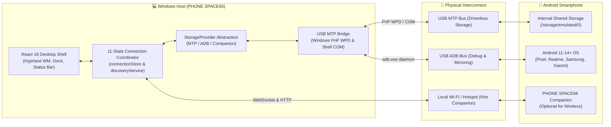

# PHONE SPACE66
> **Your Phone. Your Space. Your Desktop.**

[](https://github.com/phonespace66)
[](LICENSE)
[]()
[]()

**PHONE SPACE66** is an Android-to-Windows virtual desktop integration platform. It transforms your laptop into a high-performance desktop interface for your physical smartphone via **Plug-and-Play USB (MTP / ADB)** or **Local Network (LAN Wi-Fi / Hotspot)**.

Inspired by **Omarchy**, **Hyprland**, and modern Linux desktop environments, PHONE SPACE66 delivers a complete windowed operating environment with real phone internal storage exploration, verified bidirectional file transfers, application discovery, low-latency screen mirroring, and hardware telemetry.

---

## 🌌 Key Highlights

- **⚡ Zero-Install Wired USB Plug & Play (MTP)**:
  - Plug your Android phone into your laptop with any standard data-capable USB cable.
  - Browse and manage real internal shared storage (`DCIM`, `Download`, `Documents`, `Pictures`) directly in the File Manager with **zero apps installed on your phone** and **no developer options required**.
  - Dynamic PnP WPD device enumeration supporting **Google Pixel**, **Realme / OPPO**, **Samsung Galaxy**, **Xiaomi / POCO**, **OnePlus**, **Motorola**, and standard Android devices.
- **🖥️ Complete Hyprland-Inspired Desktop Shell**:
  - Dark monochrome aesthetic (`#050505` obsidian, `#0A0A0A` charcoal, `#171717` graphite, `#262626` borders).
  - Fluid window management (drag, resize, snap left/right, maximize, minimize, restore).
  - Super+Tab task switcher, dynamic dock, wallpaper switcher, and actionable top status bar.
- **📡 Wireless Companion Mode (LAN Wi-Fi / Hotspot)**:
  - Mutual 6-digit PIN pairing with cryptographic session tokens.
  - Live device telemetry (battery percentage, temperature, charging state, storage capacity).
  - High-performance screen mirroring with touch and keyboard event forwarding.
  - Notification synchronization, remote clipboard sharing, and media playback control.
- **🛡️ 100% Real Hardware Data — 0% Mock Data in Production**:
  - Transparent `StorageProvider` architecture (`MtpStorageProvider`, `AdbStorageProvider`, `CompanionStorageProvider`).
  - Actionable guidance when the phone is locked or set to charging-only mode.

---

## 🚀 Quick Start Guide

### 1. Launch the Windows Desktop Application

#### Option A: Native Windows Executable (.exe)
Double-click **`PHONE SPACE66.exe`** in the project root, or compile it fresh via:
```powershell
powershell -ExecutionPolicy Bypass -File .\build_exe.ps1
```

#### Option B: Developer Mode (Vite + Live Reload)
```powershell
cd d:\projects\phonespace66\desktop
npm run dev
```
*(The USB hardware bridge starts automatically in the background).*

---

### 2. Connect Your Phone via USB Cable

1. **Plug your phone into your laptop** using a data-capable USB cable.
2. **Unlock your phone screen.**
3. Swipe down your Android notification shade, tap **"Charging this device via USB"**, and select:
   - **"File Transfer"** (or **"Android Auto / Transfer files"**).
4. The top status bar will update to:
   - `USB: MTP Attached — [Your Phone Model]`
5. Click the **File Manager** icon in the dock to browse your actual phone storage!

---

## 🔍 Hardware Diagnostics & Bridge Controls

Run diagnostic commands from the project root:

```powershell
# Instant Hardware & Transport Scanner
npm run diagnostics

# Standalone USB MTP Hardware Bridge (Port 6655 WS / Port 6656 HTTP)
npm run bridge

# Master System Regression Suite (All 8 Subsystems)
npm run test
```

---

## 🏛️ System Architecture



---

## 📁 Repository Structure

```text
PHONE-SPACE66/
├── PHONE SPACE66.exe         # Native Windows GUI Application
├── PHONE SPACE66 Setup.exe   # Windows Installer
├── build_exe.ps1             # Executable build pipeline (.NET CSC)
├── scripts/
│   ├── usb_mtp_bridge.cjs    # Production USB MTP & ADB Hardware Bridge
│   ├── detect_usb_phone.cjs  # CLI hardware diagnostics utility
│   ├── Launcher.cs           # C# native launcher & embedded static web server
│   ├── Installer.cs          # C# native installer & shortcut creator
│   └── verify_system.cjs     # Master full-system regression runner
├── desktop/                  # Desktop application (React, TypeScript, Tailwind)
│   ├── src/
│   │   ├── services/storage/ # StorageProvider abstraction (MTP, ADB, Companion)
│   │   ├── services/         # discoveryService, webSocketService, fileTransferService
│   │   ├── stores/           # connectionStore (11 states), fileManagerStore
│   │   └── components/       # Hyprland WM, TopStatusBar, FileManagerWindow
├── android/                  # Native Android Companion APK (Kotlin, Jetpack Compose)
├── tests/                    # End-to-end integration & unit test suites
└── docs/                     # Technical specifications & guides
    ├── PHONE_SPACE66_ARCHITECTURE.md    # In-depth system architecture
    ├── PHONE_SPACE66_BUG_FIX_REPORT.md  # Detailed bug audit & resolution report
    └── PHONE_SPACE66_HARDWARE_TESTING.md # Physical device testing checklist
```

---

## 📚 Technical Documentation

- 🏛️ **[System Architecture](docs/PHONE_SPACE66_ARCHITECTURE.md)**: Deep dive into the 13 subsystems, data flows, and hardware integration.
- 🐛 **[Bug Fix & Audit Report](docs/PHONE_SPACE66_BUG_FIX_REPORT.md)**: Detailed technical breakdown of all repaired issues and verification results.
- 📱 **[Hardware Testing Guide](docs/PHONE_SPACE66_HARDWARE_TESTING.md)**: Practical test instructions for Google Pixel, Realme, Samsung, Xiaomi, and OnePlus phones.

---

## 📄 License

PHONE SPACE66 is released under the [MIT License](LICENSE).  
Copyright © 2026 PHONE SPACE66 Team.
