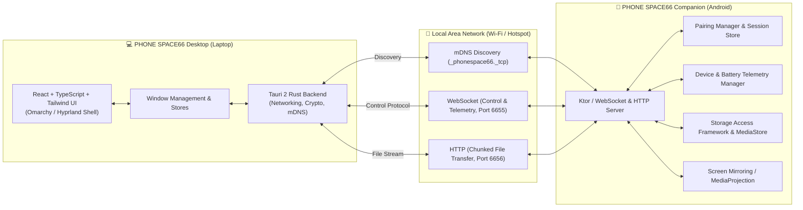

# PHONE SPACE66
> **Your Phone. Your Space. Your Desktop.**

[](https://github.com/phonespace66)
[](LICENSE)
[]()

**PHONE SPACE66** is an Android-powered virtual desktop environment that transforms your laptop into a full-featured desktop interface for your Android smartphone over a local network (Wi-Fi or Hotspot).

Inspired by **Omarchy**, **Hyprland**, **KDE Plasma**, and modern Linux desktop environments, PHONE SPACE66 delivers a complete windowed operating environment with real phone storage exploration, bidirectional file transfers, application discovery and launching, low-latency screen mirroring, and real-time device telemetry.

---

## 🌌 Key Highlights

- **Complete Linux-Inspired Desktop Environment**: Dark charcoal aesthetic, fluid window management (drag, resize, snap, minimize, maximize), top status bar, bottom dock, and full-screen application launcher.
- **Pure Local Network (LAN) Operation**: Operates peer-to-peer over local Wi-Fi or phone hotspot. **No cloud servers, external accounts, or internet connectivity required**.
- **Cryptographic Secure Pairing**: Mutual pairing via 6-digit PIN or QR code challenge, authenticated session tokens, and zero unauthenticated endpoints.
- **Real Phone Telemetry**: Live battery status, charging indicator, battery temperature, storage capacity (used/free), Wi-Fi link speed, and device specifications sourced directly from Android APIs.
- **Real File Management**: Dolphin-style phone file manager with multi-file selection, breadcrumb navigation, preview, and verified SHA-256 streaming transfers.
- **Android App Launcher**: Query actual installed applications on Android and trigger native launches via validated intents.
- **Screen Mirroring & Remote Input**: High-performance screen streaming with resolution, FPS, and bitrate controls with supported mouse and touch inputs.

---

## 🏛️ System Architecture



---

## 📁 Repository Structure

```text
PHONE-SPACE66/
├── desktop/                  # Tauri 2 + React + Vite + Tailwind desktop app
│   ├── src/                  # React desktop frontend (window manager, dock, status bar)
│   └── src-tauri/            # Rust backend (Tauri v2, mDNS discovery, crypto, sockets)
├── android/                  # Native Android Companion (Kotlin + Jetpack Compose)
│   ├── app/src/main/         # Companion UI, background service, telemetry, networking
├── shared/                   # Shared protocol definitions & JSON schemas
│   ├── protocol/             # TypeScript & JSON protocol specifications
│   └── schemas/              # JSON Schema validation files
├── tests/                    # Integration and unit tests
│   ├── desktop/              # Desktop unit and store tests
│   ├── android/              # Companion unit tests
│   └── integration/          # LAN protocol, pairing, and telemetry test harness
├── docs/                     # Technical specifications and guides
│   ├── ARCHITECTURE.md       # Detailed architectural design
│   ├── PROTOCOL.md           # Message formats and protocol specifications
│   ├── SECURITY.md           # Threat model, pairing, and encryption specs
│   ├── ANDROID_SETUP.md      # Android permissions and setup instructions
│   └── TESTING.md            # Automated and hardware-in-the-loop test procedures
├── DEVELOPMENT_STATUS.md     # Feature progress and roadmap tracking
├── TODO.md                   # Prioritized task backlog
└── README.md
```

---

## 🚀 Getting Started

### Prerequisites

- **Desktop**: Node.js 18+ (tested on v24), Rust 1.75+ (for Tauri builds), npm / pnpm.
- **Android**: Android SDK 34 (Android 10+ / API 29+ target), Java 17+, Gradle 8+.
- **Network**: Laptop and Android phone connected to the same Wi-Fi network or Phone Hotspot.

### 1. Running the Desktop Application

```bash
cd desktop
npm install
# To run in browser/development UI mode:
npm run dev

# To run as native Tauri desktop application:
npm run tauri dev
```

### 2. Building the Android Companion Application

```bash
cd android
./gradlew assembleDebug
# Install to connected device:
adb install app/build/outputs/apk/debug/app-debug.apk
```

---

## 🔒 Security Principles

- **No Cloud Dependency**: Communication never leaves your local network.
- **Explicit User Consent**: Device pairing requires explicit physical user confirmation on the Android device.
- **Cryptographic Challenges**: Random nonces and SHA-256 challenge verification prevent unauthorized reconnection.
- **Zero Shell Backdoors**: All actions follow typed, versioned protocol schemas; no arbitrary command strings or shell commands are accepted over the network.

---

## 📄 License

PHONE SPACE66 is released under the [MIT License](LICENSE).
Copyright © 2026 PHONE SPACE66 Team.

