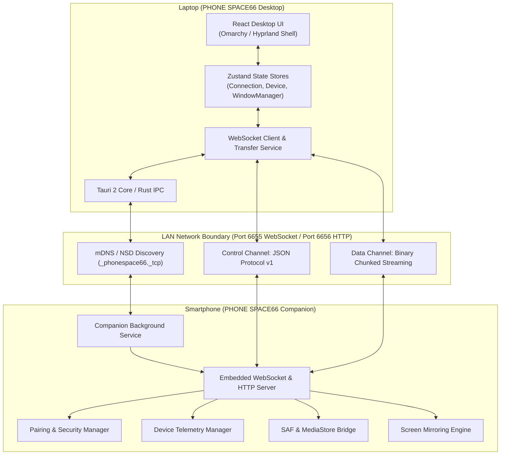

# PHONE SPACE66 Architecture Specification

## 1. System Overview

PHONE SPACE66 creates an integrated virtual desktop environment that bridges a desktop laptop (Windows 10/11 or Linux) with an Android mobile device over a Local Area Network (Wi-Fi or Hotspot).

The architecture is divided into three primary components:
1. **PHONE SPACE66 Desktop**: Built with Tauri 2 (Rust backend) and React + TypeScript + Tailwind CSS frontend.
2. **PHONE SPACE66 Companion**: Native Android application built with Kotlin and Jetpack Compose.
3. **Shared Protocol & Communication Layer**: LAN peer-to-peer transport using mDNS discovery, a secure WebSocket control channel (Port 6655), and a streaming HTTP file channel (Port 6656).

---

## 2. Desktop Component Architecture

The Desktop application is organized into modular layers:

- **Desktop Shell**:
  - `StatusBar`: Displays connected phone brand/model, live battery indicator, charging status, Wi-Fi link status, time, and quick notification counter.
  - `Dock`: Linux/macOS-style customizable dock with active running indicator lights, tooltips, and window toggle.
  - `Launcher`: Full-screen searchable app launcher modeled after Hyprland/Rofi.
  - `WindowManager`: Independent multi-window manager supporting drag, resize, maximize, minimize, z-index elevation, and snapping.
- **Application Modules (Windows)**:
  - `DeviceDashboardWindow`: Full real-time phone diagnostics (battery, CPU/RAM, storage, network).
  - `FileManagerWindow`: Dolphin-inspired file browser with directory tree, breadcrumbs, search, and transfer progress.
  - `ScreenMirrorWindow`: Low-latency video canvas with remote mouse/touch forwarder.
  - `GalleryWindow`: High-performance thumbnail grid with pagination and local preview.
  - `SettingsWindow`: Appearance, connection, shortcut, and privacy settings.
- **Services & Stores**:
  - `ConnectionStore`: Tracks discovery, pairing state, current device session, and latency.
  - `DeviceStore`: Houses device specs, battery info, storage metrics, and active notifications.
  - `WindowManagerStore`: Coordinates all open, focused, minimized, and active windows.
  - `WebSocketService`: Manages connection lifecycle, message dispatching, and heartbeat monitoring.

---

## 3. Android Companion Architecture

The Android companion application is structured cleanly into Kotlin domain packages:

- **`com.phonespace66.companion.core`**: Application lifecycle, foreground service, dependency container, and event bus.
- **`com.phonespace66.companion.networking`**:
  - `NsdDiscoveryService`: Announces the device over mDNS (`_phonespace66._tcp`).
  - `CompanionServer`: Lightweight, asynchronous Ktor/WebSocket server running on Port 6655.
  - `FileServer`: Chunked HTTP streaming endpoint running on Port 6656.
- **`com.phonespace66.companion.pairing`**:
  - `PairingManager`: Generates cryptographically secure challenges, compares 6-digit PINs, and issues signed bearer tokens stored in Android Keystore / `EncryptedSharedPreferences`.
- **`com.phonespace66.companion.device`**:
  - `DeviceTelemetryManager`: Reads hardware build properties, battery status, temperature, and storage metrics via `StatFs`.
- **`com.phonespace66.companion.storage`**:
  - `StorageManager`: Interacts with Android Storage Access Framework (SAF) and `MediaStore`.
- **`com.phonespace66.companion.ui`**:
  - Jetpack Compose interface with dark Omarchy theme, pairing prompt dialogs, and permission toggles.

---

## 4. Network & Communication Topology

- **Transport**:
  - **Signaling & Control**: JSON over WebSocket (RFC 6455) on port `6655`.
  - **High-Throughput File Transfer**: HTTP/1.1 chunked transfer with SHA-256 integrity validation on port `6656`.
  - **Discovery**: Multicast DNS (RFC 6762) using service type `_phonespace66._tcp.` on UDP port `5353`.
- **Fallback**:
  - When multicast is restricted by network hardware (e.g. some corporate or public Wi-Fi routers), the desktop provides **Direct IP Connection** where users enter the phone's LAN IP address directly.

