# PHONE SPACE66 — Comprehensive System Architecture & Engineering Audit

**Document:** `docs/PHONE_SPACE66_ARCHITECTURE.md`  
**Revision:** 2.0.0  
**Date:** November 2, 2026  
**Status:** Architecture Specification & Engineering Audit  
**Tagline:** *Your Phone. Your Space. Your Desktop.*

---

## 1. Executive Summary & Purpose

PHONE SPACE66 transforms a personal computer (laptop/desktop running Windows 10/11) into a unified, virtual desktop environment for Android smartphones. The platform supports two fundamental connection topologies:
1. **Wired Hardware Mode (Plug & Play via USB Cable)**: Operates without requiring an Android APK or developer setup using Windows Portable Devices (WPD / MTP) and ADB when authorized.
2. **Wireless Companion Mode (LAN / Wi-Fi / Hotspot)**: Connects to the native Android companion service (`_phonespace66._tcp`) for deep OS integrations including live notifications, real-time screen projection, and intent launching.

This document serves as the master engineering architecture, detailing existing data flows, identified system limitations, the multi-transport state machine, and the component design across all subsystems.

---

## 2. Existing Architecture & Data Flow

### 2.1 Multi-Layer Architecture Diagram

```mermaid
graph TD
    subgraph UI_Layer ["Desktop Presentation Layer (React 19 + TypeScript + Tailwind)"]
        DeskEnv["DesktopEnvironment & Wallpaper Engine"]
        TopBar["TopStatusBar (Live Connection & Battery Capsule)"]
        Dock["Dock (Launcher, Files, Diagnostics, Mirror, Gallery)"]
        WinMgr["Hyprland Window Manager (Snap, Drag, Z-Index)"]
        DiagWin["DeviceDashboardWindow (Telemetry & Diagnostics)"]
        FileWin["FileManagerWindow (Tree, Breadcrumbs, Grid)"]
        LaunchWin["LauncherModal (App Catalogue & Remote Launch)"]
        GalWin["GalleryWindow (Media Grid & Previews)"]
    end

    subgraph Store_Layer ["State Management (Zustand Stores)"]
        ConnStore["useConnectionStore (State Machine & Device Session)"]
        DevStore["useDeviceStore (Hardware Specs, Battery, Storage)"]
        FMStore["useFileManagerStore (CWD, Entries, Sort, Selection)"]
        AppStore["useAppStore (Package Discovery, Launch Status)"]
        GalStore["useGalleryStore (Albums, Media Items, Sync State)"]
        NotifStore["useNotificationStore (Alert Queue, Dismissals)"]
    end

    subgraph Service_Layer ["Desktop Services & Coordinators"]
        DiscServ["DiscoveryService & ConnectionCoordinator"]
        WSServ["WebSocketService (Heartbeat, Protocol Framing)"]
        FTServ["FileTransferService (StorageProvider Factory)"]
        AppServ["AppService"]
        GalServ["GalleryService"]
        ScreenServ["ScreenMirrorService"]
    end

    subgraph Bridge_Layer ["Host Hardware Bridge (scripts/usb_mtp_bridge.cjs)"]
        WS_Server["WebSocket Server (:6655/ws)"]
        HTTP_Server["HTTP Server (:6656 /download, /screen/stream)"]
        PnP_Detector["PnP & WPD Enumerator (pnputil, CIM, COM)"]
        MTP_Handler["Windows Shell Portable Devices COM Namespace(17)"]
        ADB_Handler["ADB CLI Bridge (Detection & Execution)"]
    end

    subgraph Phone_Layer ["Physical Android Smartphone"]
        MTP_Gadget["Kernel USB Gadget (MTP Interface wpdmtp.inf)"]
        ADB_Daemon["adbd (USB Debugging Interface)"]
        Companion_App["PHONE SPACE66 Companion (Ktor :6655/:6656)"]
    end

    UI_Layer <--> Store_Layer
    Store_Layer <--> Service_Layer
    Service_Layer <--> Bridge_Layer
    Bridge_Layer <--> Phone_Layer
```

---

## 3. Detailed Execution Flow (13 Core Subsystems)

1. **Application Startup**:
   - `PHONE SPACE66.exe` or `npm run dev` initializes.
   - Vite serves the React desktop shell on `http://localhost:1420`.
   - Node process launches `scripts/usb_mtp_bridge.cjs` with ports 6655 (WebSocket) and 6656 (HTTP).
2. **USB Hardware Bridge Startup**:
   - The bridge checks port bindings, sets up WebSocket `/ws` routing, and validates local loopback security.
3. **Android Device Enumeration**:
   - Bridge polls Windows PnP (`pnputil /enum-devices /class WPD`) and Windows Shell COM `Namespace(17)`.
4. **MTP Device Identification**:
   - Checks driver status (`wpdmtp.inf`), device friendly name, manufacturer, and root storage item counts.
5. **Device Discovery Lifecycle**:
   - `discoveryService.ts` probes `http://127.0.0.1:6655/ping` and LAN addresses.
6. **WebSocket Initialization & Handshake**:
   - Connects to `ws://127.0.0.1:6655/ws`, issues `PAIR_REQUEST`, validates token, starts heartbeat pings.
7. **Connection State Management**:
   - State machine in `connectionStore.ts` transitions through strict verification gates.
8. **File Browsing**:
   - `fileTransferService.ts` queries the active `StorageProvider` (MTP, ADB, or Companion).
9. **File Transfers**:
   - Streaming binary downloads and chunked uploads via HTTP 6656 with SHA-256 verification.
10. **Application Discovery**:
    - Queries Companion `PackageManager` or ADB package dump (`pm list packages -3`).
11. **Gallery Synchronization**:
    - Traverses `DCIM/Camera` and `Pictures` partitions or requests Android `MediaStore`.
12. **Notification Synchronization**:
    - Ingests USB hardware bus events and companion `NotificationListenerService` notifications.
13. **Remote Screen Functionality**:
    - Companion `MediaProjection` frame pipeline or fallback ADB screen capture.

---

## 4. Identified Problems & Root Cause Analysis

| Bug / Defect ID | Severity | Root Cause |
| :--- | :--- | :--- |
| **BUG-01: Storage Locked / 0 Items** | Critical | Android OS security locks USB storage in `CHARGING_ONLY` mode until user unlocks screen and explicitly taps *"File Transfer / Android Auto"*. |
| **BUG-02: Missing Auto-Connect** | High | `discoveryService.ts` added discovered endpoints to state but did not invoke `webSocketService.connect()`. |
| **BUG-03: Process Decoupling** | High | Running `npm run dev` in isolation did not start `usb_mtp_bridge.cjs`. |
| **BUG-04: Misleading Mock Storage** | Medium | `fileTransferService.ts` fell back to hardcoded `virtualStorage` when offline, causing confusion. |
| **BUG-05: MTP Protocol Scope** | Architectural | MTP is strictly file storage; app enumeration, notifications, and screen mirroring require Companion APK or ADB. |
| **BUG-06: Hardcoded Device Specs** | Medium | Previous bridge hardcoded `realme 9 Pro 5G` metadata instead of dynamically reading detected hardware. |

---

## 5. Hardware Communication Limitations

1. **Windows Web Sandbox Isolation**:
   - Browsers cannot access Windows COM, Win32 APIs, or USB hardware directly. A local bridge process (`usb_mtp_bridge.cjs`) on localhost is strictly required.
2. **MTP Concurrency**:
   - Windows Portable Devices API allows only one active stream at a time per MTP object. Parallel file downloads must be queued sequentially.
3. **Android Scoped Storage (Android 11-15)**:
   - Android blocks MTP access to `/Android/data` and `/Android/obb` for user privacy. All media, documents, DCIM, and downloads remain accessible.
4. **ADB Authorization Gate**:
   - ADB requires the phone to display an RSA key fingerprint challenge ("Allow USB debugging?"). The bridge must detect unauthorized states cleanly without hanging.

---

## 6. Proposed Architecture & Remediation Plan

1. **Storage Provider Pattern**:
   - `StorageProvider` interface with concrete implementations:
     - `MtpStorageProvider`: Live WPD COM bridge.
     - `AdbStorageProvider`: Direct ADB push/pull.
     - `CompanionStorageProvider`: Remote HTTP/REST bridge to Android app.
     - `MockStorageProvider`: Demo/test mode only.
2. **Multi-Transport Connection Coordinator**:
   - Independent detection of MTP, ADB, and Companion transports.
3. **Strict 11-State Connection State Machine**:
   - `disconnected` $\rightarrow$ `discovering` $\rightarrow$ `device_detected` $\rightarrow$ `awaiting_phone_unlock` $\rightarrow$ `awaiting_usb_mode` $\rightarrow$ `awaiting_adb_authorization` $\rightarrow$ `connecting` $\rightarrow$ `connected` $\rightarrow$ `synchronizing` $\rightarrow$ `reconnecting` $\rightarrow$ `error`.
4. **Vite & Package Orchestration**:
   - `npm run dev` concurrently manages Vite + USB Hardware Bridge with health checks and clean teardown.

