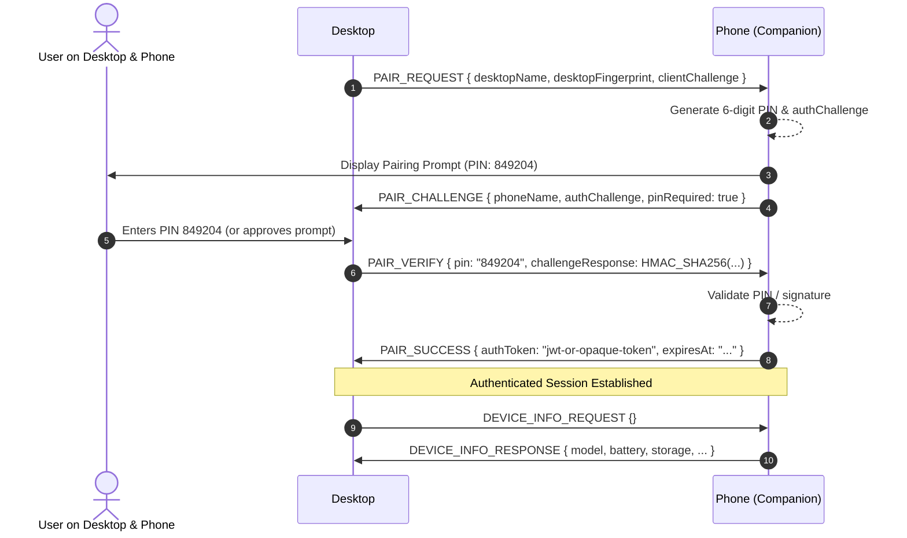

# PHONE SPACE66 Communication Protocol Specification

**Protocol Version**: `1`  
**Wire Format**: JSON (UTF-8 encoded)  
**Control Port**: `6655` (WebSocket)  
**File Data Port**: `6656` (HTTP)

---

## 1. Envelope Structure

Every message sent across the control WebSocket must conform to the following envelope:

```json
{
  "protocolVersion": 1,
  "messageId": "550e8400-e29b-41d4-a716-446655440000",
  "requestId": "123e4567-e89b-12d3-a456-426614174000",
  "type": "MESSAGE_TYPE_NAME",
  "timestamp": "2026-11-01T11:00:00.000Z",
  "authToken": "session-bearer-token-if-authenticated",
  "payload": {}
}
```

### Fields

- `protocolVersion` (*integer*, required): Must equal `1`.
- `messageId` (*string*, required): Unique UUID identifying this message.
- `requestId` (*string*, optional): Correlation UUID for request-response pairing.
- `type` (*string*, required): Protocol message identifier.
- `timestamp` (*string*, required): ISO-8601 UTC timestamp.
- `authToken` (*string*, optional): Bearer token generated during pairing (required after handshake).
- `payload` (*object*, required): Type-specific message payload.

---

## 2. Pairing & Authentication Workflow



### Message Types

#### `PAIR_REQUEST`
Initiated by Desktop to start pairing.
```json
{
  "type": "PAIR_REQUEST",
  "payload": {
    "desktopName": "ArchLaptop",
    "desktopId": "desktop-uuid-1234",
    "publicKey": "base64-fingerprint"
  }
}
```

#### `PAIR_CHALLENGE`
Returned by Companion asking for user verification.
```json
{
  "type": "PAIR_CHALLENGE",
  "payload": {
    "phoneName": "Pixel 8 Pro",
    "challenge": "b64-random-challenge-bytes",
    "pin": "849204"
  }
}
```

#### `PAIR_VERIFY`
Desktop submits the entered PIN or signature.
```json
{
  "type": "PAIR_VERIFY",
  "payload": {
    "pin": "849204",
    "challengeResponse": "sha256-hash-of-challenge-and-secret"
  }
}
```

#### `PAIR_SUCCESS`
Returned when approved.
```json
{
  "type": "PAIR_SUCCESS",
  "payload": {
    "authToken": "pst_9f4c3a2b1e0d...",
    "expiresAt": 1762000000000
  }
}
```

---

## 3. Device Telemetry Messages

#### `DEVICE_INFO_REQUEST`
Sent by Desktop to query full device status.
```json
{
  "type": "DEVICE_INFO_REQUEST",
  "authToken": "pst_9f4c3a2b1e0d...",
  "payload": {}
}
```

#### `DEVICE_INFO_RESPONSE`
Returned by Android Companion with actual phone metrics.
```json
{
  "type": "DEVICE_INFO_RESPONSE",
  "payload": {
    "device": {
      "manufacturer": "Google",
      "model": "Pixel 8 Pro",
      "marketName": "Pixel 8 Pro",
      "androidVersion": "14",
      "sdkInt": 34,
      "uptimeMs": 48291030
    },
    "battery": {
      "level": 84,
      "isCharging": true,
      "chargingSource": "USB_PD",
      "temperatureCelsius": 29.5,
      "health": "GOOD"
    },
    "storage": {
      "totalBytes": 128000000000,
      "availableBytes": 45200000000,
      "usedBytes": 82800000000
    },
    "network": {
      "ipAddress": "192.168.1.145",
      "ssid": "Home-5G",
      "linkSpeedMbps": 866
    }
  }
}
```

#### `HEARTBEAT` & `HEARTBEAT_ACK`
Sent periodically (every 5 seconds) to ensure connection integrity and measure latency.
```json
{
  "type": "HEARTBEAT",
  "payload": { "clientTimestamp": 1730460000123 }
}
```
Response:
```json
{
  "type": "HEARTBEAT_ACK",
  "payload": { 
    "clientTimestamp": 1730460000123,
    "serverTimestamp": 1730460000130
  }
}
```

---

## 4. Error Response Format

#### `ERROR_RESPONSE`
```json
{
  "type": "ERROR_RESPONSE",
  "payload": {
    "code": "AUTH_REQUIRED",
    "message": "Bearer token invalid or session expired",
    "details": null
  }
}
```

Standard Error Codes:
- `AUTH_REQUIRED`: Endpoint requires valid pairing token.
- `PAIRING_REJECTED`: User denied pairing on phone.
- `PAIRING_TIMEOUT`: Pairing verification timed out.
- `STORAGE_ACCESS_DENIED`: Requested directory lacks SAF permission.
- `FILE_NOT_FOUND`: Specified path does not exist.
- `INTERNAL_ERROR`: Unexpected internal exception.

